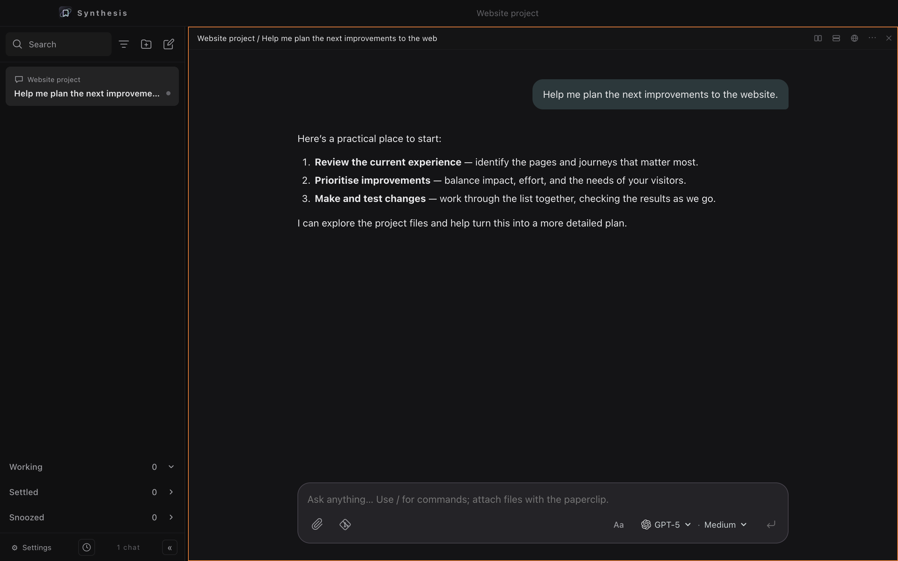

# Synthesis

Synthesis is a desktop workspace for working with an AI coding agent alongside the tools and project files it needs. It brings conversations, a terminal, a browser, file previews, and Git controls into one place, so you can explore a project, make changes, and follow the work without constantly switching apps.

The chat interface uses the [Pi coding agent](https://github.com/badlogic/pi-mono) and its configured models. Projects give conversations a working directory, while the sidebar makes it easier to return to ongoing work, settle finished threads, or snooze a conversation until later.



*An example conversation in a project workspace. The screenshots on this page use demonstration content.*

## What you can do

- **Work with an agent:** chat about a project, attach files and folders, select an available model, and adjust its reasoning level when supported.
- **Organise conversations:** search and filter threads by project, keep track of working and settled chats, and snooze threads for later.
- **Keep tools together:** split the workspace into panes and use terminal and browser tabs alongside a conversation. Browse project files and open read-only previews.
- **Work with Git:** inspect changes and diffs, stage files, commit, and manage repository connections from the workspace.
- **Make it yours:** adjust appearance and keyboard shortcuts in Settings.

## Getting started

You will need Node.js and npm, plus the Pi coding agent installed and configured with access to the model providers you want to use. Synthesis looks for `pi` at `~/.local/bin/pi` or on your `PATH`. Follow the [Pi project’s setup instructions](https://github.com/badlogic/pi-mono) for installation and provider authentication.

From the project directory:

```sh
npm ci
npm start
```

Create a project for a working directory, start a chat, and select an available model. The application can also run chats without assigning them to a project.

The `node-pty` post-install check attempts to rebuild its native binding if the bundled prebuild cannot start a process. If you need to force a rebuild:

```sh
npm_config_build_from_source=true npm rebuild node-pty
```

### Build the macOS app

```sh
npm run package
```

The packaging script creates an ad-hoc signed Apple Silicon bundle at `dist/Synthesis-darwin-arm64/Synthesis.app`.

## Development

```sh
npm test                  # unit tests
npm run test:integration  # Electron integration tests
npm run benchmark:loading # five-run local loading benchmark
```

Integration tests use temporary user-data directories. Local application state, session logs, dependencies, and generated builds are excluded from the repository by `.gitignore`.

The main Electron process is in `main.js`, the renderer in `renderer.js`, `index.html`, and `styles.css`, and shared functionality lives in `lib/`. The `test/` directory contains unit and integration tests; `design-explorations/` contains interface experiments.

### Synthesis skills

Open **Settings → Skills** to see the Synthesis skill library and import individual skills from Pi's global `skills` directory (`$PI_CODING_AGENT_DIR/skills`, or `~/.pi/agent/skills`). Imports are copies; a skill already in the library is never overwritten. Pi's automatic skill discovery is disabled in Synthesis chats and scheduled tasks. Pi package and project skill directories are not currently scanned for import.

To use a skill, type `$name` in a chat message and select the skill from the menu, or select it in the scheduled task form. The `$` picker includes only skills saved in the Synthesis library. Newly created skills and edits appear in the current session automatically, including while the picker is open; no restart or Settings visit is needed. Scheduled tasks load the current library version each time they run and report an error if it has been removed. When you ask the agent to create a skill, it is instructed to use the Synthesis library by default. Skills may refer to supporting files in their own directory, provided the agent can access them.

The library path is displayed in Settings. To add a skill manually, create a folder named after the skill containing a `SKILL.md` file with `name` and `description` in YAML frontmatter. Names use lowercase letters, numbers and hyphens. Descriptions can use a single line or an indented YAML `>`/`|` block. Markdown files saved directly in the Synthesis library are also recognized; a matching `name/SKILL.md` takes precedence over a duplicate loose file. Supporting files can live alongside `SKILL.md`. Skills can contain instructions or executable resources; review a skill before importing and using it.
